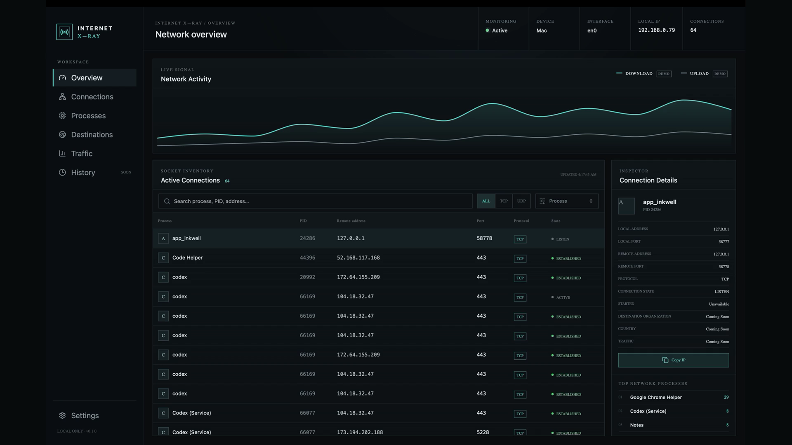

# Internet X-Ray

**See what your computer is talking to.**

Internet X-Ray is a local-first macOS desktop application for inspecting active network connections. Milestone 1 identifies the processes using the network, their local and remote endpoints, protocols, ports, and socket states in a dense, real-time technical interface.



Connections are classified as Internet, LAN, Local, or Listening so remote traffic is not confused with communication inside the Mac or the local network.

## Why it exists

Operating systems expose rich network state, but it is commonly buried in terminal tools or presented without useful process context. Internet X-Ray makes that state legible while keeping inspection entirely on the computer being observed.

## Architecture

- `src/` contains the React/TypeScript interface, typed frontend models, polling, filtering, sorting, and presentation.
- `src-tauri/src/commands/` is the narrow Tauri command boundary.
- `src-tauri/src/network/` contains shared connection models and platform-specific collection.
- `src-tauri/src/system/` collects device and interface information.

React invokes the typed `get_system_info` and `get_connections` Rust commands using Tauri IPC. The connections command runs every two seconds. Rust invokes macOS's read-only `/usr/sbin/lsof` socket inventory and parses its machine-oriented field output. Because `lsof` reports the owning command and PID along with each socket, process matching does not depend on guesses or a separate timing-sensitive process scan.

## Technology

Tauri 2, React 18, TypeScript, Vite, Rust, Recharts, and Lucide icons. SQLite and event-driven streaming are intentionally reserved for later milestones.

## Privacy philosophy

All device, process, and connection information remains local. The app has no analytics, accounts, cloud backend, data upload, remote API, packet capture, or payload inspection. It executes a fixed system command with fixed arguments; network-derived values are never executed.

## Supported platforms

Milestone 1 supports **macOS** connection collection. The platform boundary is explicit so native Windows and Linux collectors can be added later; those platforms currently return a clear unsupported-platform error.

## Requirements

- macOS
- Node.js 20 or newer and npm
- Rust stable toolchain
- Apple Xcode Command Line Tools (`xcode-select --install`)

Install and run:

```bash
npm install
npm run tauri dev
```

Frontend-only development is available with `npm run dev`, but system inspection deliberately reports an error outside the Tauri desktop runtime.

Build the desktop application:

```bash
npm run build
npm run tauri build
```

Quality checks:

```bash
npm run lint
cargo test --manifest-path src-tauri/Cargo.toml
cargo clippy --manifest-path src-tauri/Cargo.toml -- -D warnings
```

## Current limitations

- Connection snapshots are polling-based and may miss very short-lived sockets.
- macOS may hide sockets owned by other users or protected processes unless the app is run with elevated privileges. Normal use should not require elevation; prefer partial visibility over running the UI as root.
- UDP is connectionless. Unconnected UDP sockets have no remote peer and are grouped with listening sockets in Milestone 1.
- Process names use the command name exposed by `lsof`, which can be truncated.
- Connection start time, byte rates, destination organization, country, and history are unavailable in Milestone 1.
- The activity chart is explicitly labeled demo data. No other system value is fabricated.

## Roadmap

- **Milestone 1:** Active connection monitoring
- **Milestone 2:** Per-process bandwidth monitoring
- **Milestone 3:** DNS and hostname resolution
- **Milestone 4:** Destination intelligence / ASN information
- **Milestone 5:** Interactive network visualization
- **Milestone 6:** Connection history
- **Milestone 7:** Alerts and anomaly detection
- **Milestone 8:** Windows and Linux support
